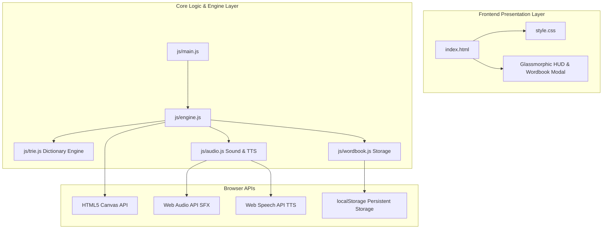

# Wordtris Tower (워드트리스 타워) Implementation Plan

> **For agentic workers:** REQUIRED SUB-SKILL: Use superpowers:subagent-driven-development to implement this plan task-by-task. Steps use checkbox (`- [ ]`) syntax for tracking.

**Goal:** Create a high-end educational Tetris-style word completion web application ("Wordtris Tower") supporting Korean Jamo & English Alphabet block falling, Trie dictionary search, explosion effects, chain combos, Web Speech TTS, and Wordbook archiving.

**Architecture:** HTML5 Canvas API + ES6 Modular JavaScript (`js/trie.js`, `js/audio.js`, `js/wordbook.js`, `js/engine.js`, `js/main.js`) + Vanilla CSS3 with Glassmorphic Library styling.

**Architecture Diagram:**

**Tech Stack:** HTML5, CSS3 Glassmorphism, Vanilla ES6 JavaScript, Web Audio API, Web Speech API (TTS), HTML5 Canvas.

## Global Constraints
- Target workspace: `d:\Antigravity\wordtris-tower\`
- Grid size: 6 Columns x 12 Rows
- Browser APIs: HTML5 Canvas, Web Audio API, Web Speech API (`speechSynthesis`), `localStorage`
- Language modes: `ko-KR` (한글 자음/모음 조합 및 초등 3,000 단어) and `en-US` (영문 알파벳 및 초등 1,500 단어)

---

### Task 1: HTML Structure & Glassmorphic Library Design System
**Files:**
- Create: [`index.html`](file:///d:/Antigravity/wordtris-tower/index.html)
- Create: [`style.css`](file:///d:/Antigravity/wordtris-tower/style.css)

**Interfaces:**
- Consumes: Google Fonts (Outfit, Noto Sans KR)
- Produces: Game container `#app`, Canvas `#game-canvas`, HUD controls, Wordbook modal `#wordbook-modal`, Mobile touch D-pad.

- [ ] **Step 1: Create `index.html` markup**
Create semantic page structure with HUD header (Score, Level, Combo, Language Toggle, Sound Toggle, Wordbook Modal), central canvas container, right sidebar / stats, and mobile control overlay.

- [ ] **Step 2: Create `style.css` glassmorphic styling system**
Implement CSS variables for deep navy background (`#0A0E1A`), glassmorphic panels (`backdrop-filter: blur(12px)`), neon block glows (Consonants: Amber, Vowels: Cyan, English: Pink/Emerald), glowing gold text, button animations, modal overlays, and responsive breakpoints.

---

### Task 2: Trie Dictionary Engine
**Files:**
- Create: [`js/trie.js`](file:///d:/Antigravity/wordtris-tower/js/trie.js)

**Interfaces:**
- Consumes: Elementary Hangul (~3,000 words) & English (~1,500 words) vocabulary arrays.
- Produces: `TrieNode`, `TrieDictionary` class with methods `insert(word, meaning)`, `isWord(word)`, `startsWith(prefix)`, `scanContiguousWords(letterArray)`.

- [ ] **Step 1: Implement `TrieNode` and `TrieDictionary` class**
Build tree node with `children` map, `isEndOfWord` boolean, and `meaning` metadata.

- [ ] **Step 2: Populate elementary Korean & English dictionaries**
Build built-in dataset of Korean elementary nouns/verbs (e.g., 사과, 학교, 하늘, 바다, 고양이, 붕어빵, 사자, 호랑이, 책상, 연필, 친구, 가방...) and English words (e.g., CAT, DOG, APPLE, BOOK, SUN, MOON, STAR, TREE, FISH, BIRD, SKY, RAIN, DESK, SONG, PLAY...).

- [ ] **Step 3: Implement contiguous string scanner**
Add `scanContiguousWords(letters)` that extracts valid words of length 2..6 along any 1D array of letters in $O(K)$ time.

---

### Task 3: Sound Synthesizer & Web Speech TTS
**Files:**
- Create: [`js/audio.js`](file:///d:/Antigravity/wordtris-tower/js/audio.js)

**Interfaces:**
- Consumes: Web Audio API `AudioContext`, Web Speech API `speechSynthesis`.
- Produces: `SoundSynth` class with methods `playMove()`, `playDrop()`, `playExplode()`, `playCombo(comboCount)`, `playReroll()`, `playGameOver()`, `speakWord(word, lang)`.

- [ ] **Step 1: Implement Web Audio API procedural SFX**
Construct synth oscillators and gain nodes to generate clean, retro-modern sound effects without needing external MP3 asset downloads.

- [ ] **Step 2: Implement Web Speech API TTS voice player**
Implement `speakWord(word, lang)` supporting Korean (`ko-KR`) and English (`en-US`) speech synthesis with volume & pitch parameters.

---

### Task 4: Wordbook Collection & Persistence Manager
**Files:**
- Create: [`js/wordbook.js`](file:///d:/Antigravity/wordtris-tower/js/wordbook.js)

**Interfaces:**
- Consumes: Matched word data from game engine.
- Produces: `Wordbook` class with methods `addWord(word, meaning, lang)`, `getWords(lang)`, `search(query)`, `renderModal()`, `saveToStorage()`, `loadFromStorage()`.

- [ ] **Step 1: Implement `Wordbook` state manager**
Store collected words with timestamp, count, definition, and language tag in `localStorage`.

- [ ] **Step 2: Build interactive modal UI renderer**
Render card grid inside `#wordbook-modal` displaying word, definition, TTS audio button, and search input bar.

---

### Task 5: Wordtris Tower Game Engine & Physics
**Files:**
- Create: [`js/engine.js`](file:///d:/Antigravity/wordtris-tower/js/engine.js)

**Interfaces:**
- Consumes: `TrieDictionary`, `SoundSynth`, `Wordbook`, Canvas 2D Context.
- Produces: `WordtrisEngine` class managing grid matrix, falling blocks, Hangul composition, word explosion particles, gravity drops, and chain combos.

- [ ] **Step 1: Implement 6x12 Matrix & Falling Block State**
Define grid array `board[12][6]`. Generate falling blocks (weighted consonants/vowels or alphabets). Implement block movement (`left`, `right`, `softDrop`, `hardDrop`, `reroll`).

- [ ] **Step 2: Implement Hangul Jamo Composition Engine**
Add dynamic Hangul assembly formula (`0xAC00 + (initial * 21 + medial) * 28 + final`) so adjacent consonant + vowel cells in grid dynamically display as formatted Hangul syllables.

- [ ] **Step 3: Implement Word Detection & Explosive Particle System**
Scan horizontal rows (Left-to-Right) and vertical columns (Top-to-Bottom) for dictionary matches. Highlight matched cells in gold/neon, burst particles, clear cells, play SFX & TTS.

- [ ] **Step 4: Implement Gravity Drop & Chain Combo Loop**
After clearing cells, drop upper blocks down. Check if new arrangement forms secondary words. Award exponential combo scores (`Combo x2`, `Combo x3`).

---

### Task 6: Main Entry & UI Integration
**Files:**
- Create: [`js/main.js`](file:///d:/Antigravity/wordtris-tower/js/main.js)

**Interfaces:**
- Consumes: `WordtrisEngine`, `Wordbook`, `SoundSynth`, DOM elements.
- Produces: App bootstrap, game loop initialization, language mode switching (`KR` / `EN`), modal toggles, keyboard & touch button event listeners.

- [ ] **Step 1: Wire all components in `js/main.js`**
Initialize instances of Trie, Audio, Wordbook, and Engine. Connect keyboard shortcuts (`←`, `→`, `↓`, `Space`, `R`, `P`) and mobile touch controls.

- [ ] **Step 2: Implement Game Over, Restart & High Score handling**
Handle top grid boundary overflow (Game Over state). Save and render high scores in `localStorage`.

---

### Task 7: Verification & Testing
- Run browser preview / HTTP server to verify UI rendering, block drop physics, word explosion particles, sound effects, TTS pronunciation, and Wordbook persistence.
